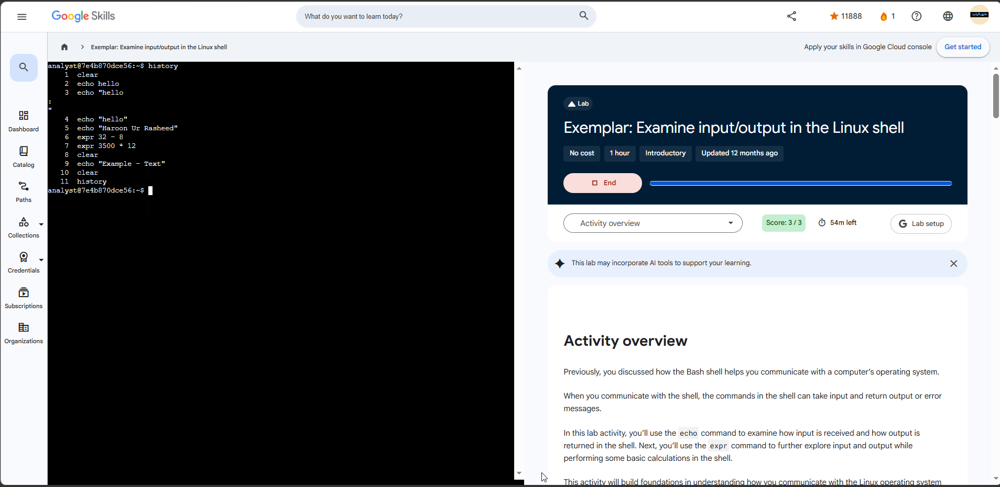

# Lab 02 — Examine input/output in the Linux shell

**Program:** Google Cybersecurity Professional Certificate — Google Skills
**Date completed:** 2026-11-02
**Score:** 3 / 3
**Level / duration:** Introductory, 1 hour (completed with 50 min left)
**Environment:** Linux Bash shell, user `analyst`

## Objective

Understand how the Bash shell handles input and output: send commands as input, read the returned output or errors, and perform basic integer calculations in the shell.

## Tasks completed

1. **Generate output with the `echo` command** — output plain and quoted strings, including his own name in full capitals.
2. **Generate output with the `expr` command** — performed the two scenario calculations (below).
3. **Clear the Bash shell** — used `clear` to reset the terminal.
4. **Optional exploration** — ran additional `echo` / `expr` combinations (see history), testing how the shell treats text, operators, and the `*` character differently in `echo` vs `expr`.

## Scenario calculations

| Question | Command | Result |
|----------|---------|--------|
| 32 alerts total, 8 required action — how many false positives? | `expr 32 - 8` | **24** |
| 3,500 login attempts/month — expected total in a year? | `expr 3500 * 12` | **42,000** |

## Commands used (from terminal history in evidence screenshot)

```bash
clear
echo hello
echo "hello"
echo "HAROON UR RASHEED"
expr 32 - 8
expr 3500 * 12
clear
# optional exploration
echo hello * 8
expr 1 * 8
expr 44 * 44
expr 1983 / 43
history
```

## Clean exemplar run (added 2026-11-02 — primary evidence)

The first screenshot for this lab (his own run, 20 commands) was fuzzy. The exemplar screenshot below is the clean version of the same activity — page titled “Exemplar: Examine input/output in the Linux shell”, **Score: 3/3, 54m left**, host `analyst@7e4b870dce56` — and is now the primary evidence for this entry. Its `history` is short and fully readable:

```bash
clear
echo hello
echo "hello          # unterminated quote — shell showed continuation prompts (: / ")
echo "hello"
echo "Haroon Ur Rasheed"
expr 32 - 8
expr 3500 * 12
clear
echo "Example - Text"
clear
history
```

Note the name in this run is in proper case — `Haroon Ur Rasheed` — not all capitals as in the first run, and line 3 usefully shows what an unterminated quote does in Bash: the shell waits for more input instead of running the command.



## Key concepts verified

- A command is **input** to the shell; the text/result returned is **output** — and errors are output too, to be read, not ignored.
- Quoting with `"..."` groups characters into one string for the shell.
- `expr` does **integer-only** maths, and every term and operator must be separated by spaces (`expr 32 - 8`, not `expr 32-8`).
- `clear` resets a cluttered terminal so current work is readable.

## Verification

- `echo` returned the exact strings entered, with and without quotation marks.
- `expr` returned 24 for the false-positive calculation and 42,000 for the yearly login estimate.
- All 3 lab checks passed: **Score 3 / 3**.

## Why this matters for a security analyst

Every later Linux task depends on this: reading shell output vs error messages correctly, and doing quick, accurate triage maths in the terminal — e.g. false-positive counts from an alert queue, or scaling a monthly login figure to a yearly exposure estimate — without leaving the shell.

## Portfolio blurb (copy-ready)

> Completed a hands-on Bash lab (3/3) on shell input/output: used `echo` with quoted and unquoted strings, `expr` for integer calculations in analyst scenarios (24 false positives from 32 alerts; 42,000 expected yearly logins from 3,500/month), and `clear` to manage the terminal — plus self-directed exploration of how the shell handles operators in `echo` vs `expr`.

## Evidence

- **Primary (clean):** `~/workspace/user/media_library/image/image-7.png` — Exemplar page, Score: 3/3, 54m left, clean 11-command `history`. Copy in this folder: `lab-02-exemplar-screenshot.png`.
- Supporting (fuzzy, superseded as primary): `~/workspace/user/media_library/image/image-6.png` — his own run, Score: 3/3, 50m left, 20-command `history` including optional exploration.
