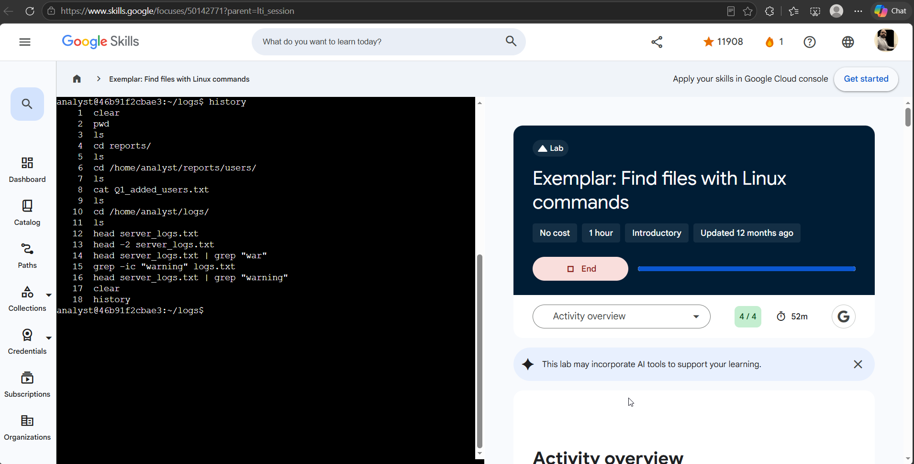

# Lab 03 — Find files with Linux commands

**Program:** Google Cybersecurity Professional Certificate — Google Skills
**Date completed:** 2026-11-02
**Score:** 4 / 4
**Level / duration:** Introductory, 1 hour (completed with 52 min left)
**Environment:** Linux Bash shell, user `analyst`, working in `/home/analyst`
**Evidence note:** The screenshot for this lab is the page titled “Exemplar: Find files with Linux commands” (Score 4/4) — labelled as such here, same as Lab 02.

## Objective

Navigate a Linux file structure from the shell (no GUI), locate specific files, read their contents, and answer questions from the data found in them — the same workflow used to pull a user access report during an unauthorized-access investigation.

## Tasks completed

1. **Get current directory information** — `pwd` + `ls` in the home directory.
2. **Change directory and list subdirectories** — navigated to `/home/analyst/reports` and listed its subdirectory.
3. **Locate and read a file** — navigated to `/home/analyst/reports/users`, listed files, and read `Q1_added_users.txt` with `cat`.
4. **Navigate and examine a log file** — navigated to `/home/analyst/logs`, listed its file, and displayed the first 10 lines of `server_logs.txt` with `head`.

## Findings (answers extracted from the files)

| Question | Answer |
|----------|--------|
| Current working directory | `/home/analyst` |
| Directories contained in the current working directory | Four |
| Subdirectory inside `/home/analyst/reports` | `users` |
| Department of employee `aezra` (from `Q1_added_users.txt`) | Human Resources |
| `employee_id` of `mreed`, Information Technology | 1104 |
| Warning messages in the first 10 lines of `server_logs.txt` | Three |

## Commands used (from terminal history in evidence screenshot)

```bash
clear
pwd
ls
cd reports/
ls
cd /home/analyst/reports/users/
ls
cat Q1_added_users.txt
ls
cd /home/analyst/logs/
ls
head server_logs.txt          # first 10 lines (default)
head -2 server_logs.txt       # exploration: first 2 lines only
head server_logs.txt | grep "war"
grep -ic "warning" logs.txt
head server_logs.txt | grep "warning"
clear
history
```

## Exploration beyond the scripted tasks

The history goes past the required commands, into log-search technique:
- `head -2` — limiting output to an exact line count.
- Piping `head` into `grep` (`head server_logs.txt | grep "warning"`) to filter only warning lines from the top of a log.
- `grep -ic "warning" logs.txt` — case-insensitive count of matches. Note: it was aimed at `logs.txt`, while the file in that directory is `server_logs.txt` — the follow-up pipe against `server_logs.txt` is the corrected version. Recorded as-is: checking the exact filename with `ls` before grepping is the lesson.

## Verification

- Each task's “Check my progress” passed, including the file-content questions (user department, employee ID, warning count) — answers came from reading the files, not guessing.
- All 4 lab checks passed: **Score 4 / 4**.

## Why this matters for a security analyst

This is daily SOC muscle memory: `pwd`/`ls`/`cd` to locate evidence, `cat`/`head` to read reports and logs, and `grep` to pull the lines that matter out of a log too big to read whole. The lab scenario — finding who was added in Q1 and counting warnings in a server log — is exactly an access-review / log-triage task.

## Portfolio blurb (copy-ready)

> Completed a hands-on Linux lab (4/4) navigating the file system with `pwd`, `ls`, and `cd`, reading files with `cat` and `head`, and extracting answers from the data: located `Q1_added_users.txt` to identify an employee's department and ID, and counted warning messages in `server_logs.txt`. Also practised filtering log output by piping `head` into `grep`.

## Evidence

- Screenshot: `~/workspace/user/media_library/image/image-8.png` — Exemplar page, Score: 4/4, 52m left, full 18-command terminal `history`. Copy in this folder: `lab-03-screenshot.png`.


