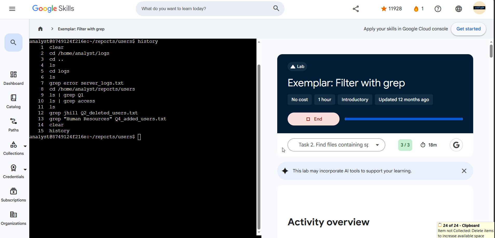

# Lab 04 — Filter with grep

**Program:** Google Cybersecurity Professional Certificate — Google Skills
**Date completed:** 2026-11-02
**Score:** 3 / 3
**Level / duration:** Introductory, 1 hour (completed with 47 min left)
**Environment:** Linux Bash shell, user `analyst` (`~/logs`, then `~/reports/users`)
**Evidence note:** First screenshot is his own run (“Activity: Filter with grep”; history lines 5–36 visible, lines 1–4 scrolled off). A clean exemplar screenshot was added later the same day and is now the primary evidence — see the exemplar section below.

## Objective

Use `grep` and piping (`|`) to (1) pull specific lines out of a file's contents and (2) filter a list of filenames down to those containing a given string.

## Tasks completed

1. **Search for error messages in a log file** — navigated to `/home/analyst/logs` and ran `grep error server_logs.txt` to return only error lines.
2. **Find files containing specific strings** — in `/home/analyst/reports/users`, piped `ls` into `grep` to list files with `Q1` in the name, then files with `access` in the name.
3. **Search more file contents** — searched `Q2_deleted_users.txt` for username `jhill`, and `Q4_added_users.txt` for users added to Human Resources (quoted multi-word string).

## Findings (answers extracted from the files)

| Question | Answer |
|----------|--------|
| Error lines in `server_logs.txt` | **Six** |
| Files in `reports/users` with `Q1` in the name | **Three** |
| Files in `reports/users` with `access` in the name | **Four** |
| Username `jhill` found in `Q2_deleted_users.txt`? | **Yes** |
| Users added to Human Resources in Q4 | **Two** |

## Commands used (from terminal history in evidence screenshot)

```bash
grep error server_logs.txt
grep error server_logs.txt -h
cd ..
cd reports/
ls
cd users/
ls
ls | grep Q1
ls | grep access
ls | grep "access"
cat Q2_deleted_users.txt | grep jhill
cat Q4_added_users.txt | grep Human
cat Q4_added_users.txt | grep "Human Resources"
cd /home/analyst/reports/users/
ls | grep "Q1"
ls | grep Q1
ls | grep "access"
ls | grep access
clear
history
```

## Working notes — trial, error, correction

The history shows real iteration, kept here as-is:
- `ls grep Q1` / `ls grep "access"` (lines 15, 18) — the pipe missing, so `grep` was treated as an `ls` argument. The corrected `ls | grep ...` form follows immediately and is used cleanly in the final run (lines 31–34).
- `cls` (line 25) — the Windows clear command; Bash uses `clear`, used at line 35.
- `grep Human` before `grep "Human Resources"` (lines 22–23) — shows why multi-word strings must be quoted.
- Also worth noting: the lab text itself reverses the pipe direction in one note (“the output of the grep command is piped to the ls command”). In the actual commands, `ls` output is piped **into** `grep` — the history proves the correct direction.

## Verification

- All three “Check my progress” tasks passed, including the counted answers (6 error lines; 3 Q1 files; 4 access files; 2 HR additions in Q4; jhill present in Q2 deleted users).
- Final history lines repeat the correct pipe forms unquoted and quoted — the technique landed.
- **Score 3 / 3.**

## Why this matters for a security analyst

`grep` is the analyst's scalpel: isolating error lines in a server log, confirming whether a specific username appears in a deleted-users file, and counting how many users were added to a department in a quarter are all access-review and incident-triage tasks. Piping `ls | grep` extends the same filtering from file *contents* to file *names*.

## Portfolio blurb (copy-ready)

> Completed a hands-on Linux lab (3/3) filtering with `grep` and pipes: extracted all error lines from `server_logs.txt` (6), listed files by name pattern in a users directory (`ls | grep Q1` → 3 files; `access` → 4 files), confirmed a deleted username (`jhill`) in `Q2_deleted_users.txt`, and counted Q4 Human Resources additions (2) using a quoted multi-word grep search.

## Clean exemplar run (added 2026-11-02 — primary evidence)

Page titled “Exemplar: Filter with grep”, **Score: 3/3, 18m left**, host `analyst@8749124f216e`, working in `~/reports/users`. The full 15-command `history` is clean and fully readable — the canonical form of the same tasks, with no trial-and-error:

```bash
clear
cd /home/analyst/logs
cd ..
ls
cd logs
ls
grep error server_logs.txt
cd /home/analyst/reports/users
ls | grep Q1
ls | grep access
ls
grep jhill Q2_deleted_users.txt
grep "Human Resources" Q4_added_users.txt
clear
history
```

Note the direct form here — `grep jhill Q2_deleted_users.txt` and `grep "Human Resources" Q4_added_users.txt` — versus the `cat file | grep ...` form in his own run. Both work; grep with a filename argument is the cleaner habit.

The exemplar text also prints the official answers, and **all five match the findings recorded from his own run**: six error lines; three Q1 files; four access files; jhill — Yes; two users added to Human Resources in Q4. (The exemplar repeats the course's reversed pipe note — “the output of the grep command is piped to the ls command” — which is still backwards; the commands themselves pipe `ls` into `grep`.)



## Evidence

- **Primary (clean):** `~/workspace/user/media_library/image/image-10.png` — Exemplar page, Score: 3/3, 18m left, clean 15-command `history`. Copy in this folder: `lab-04-exemplar-screenshot.png`.
- Supporting (his own run): `~/workspace/user/media_library/image/image-9.png` — Activity page, Score: 3/3, 47m left, terminal `history` lines 5–36. Copy in this folder: `lab-04-screenshot.png`.


