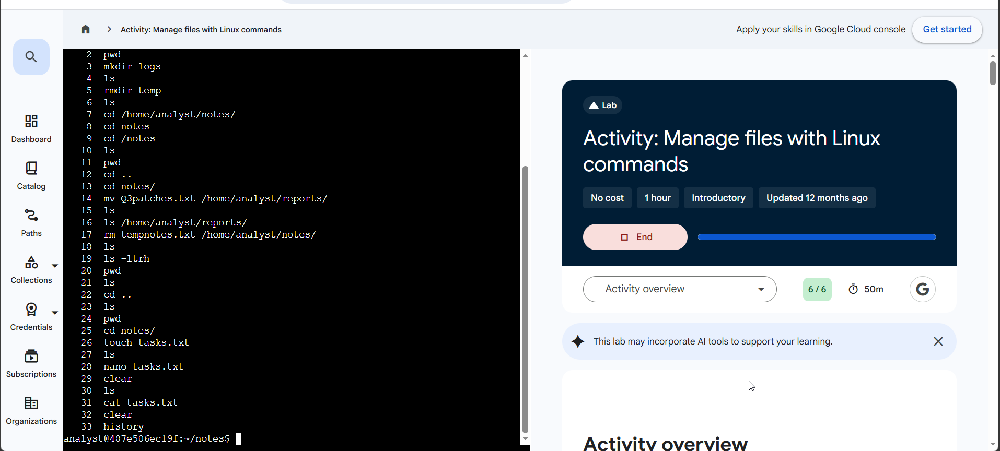

# Lab 05 — Manage files with Linux commands

**Program:** Google Cybersecurity Professional Certificate — Google Skills
**Date completed:** 2026-11-02
**Score:** 6 / 6
**Level / duration:** Introductory, 1 hour (completed with 50 min left, per screenshot)
**Environment:** Linux Bash shell, user `analyst`, ending in `~/notes`
**Evidence note:** Screenshot is his own run (“Activity: Manage files with Linux commands”); history lines 2–33 visible, line 1 scrolled off.

## Objective

Reorganise the `/home/analyst` directory to a target structure — create and remove directories, move and delete files — then create a new file and document the work in it using the nano editor, verifying every change with `ls`.

## Start → target structure

**Started as:** `notes/` (Q3patches.txt, tempnotes.txt), `reports/` (Q1patches.txt, Q2patches.txt), `temp/`

**Required result — achieved:**
```
analyst/
├── logs/                      (new, empty)
├── notes/
│   └── tasks.txt              (new, with note added)
└── reports/
    ├── Q1patches.txt
    ├── Q2patches.txt
    └── Q3patches.txt          (moved from notes/)
```
`temp/` removed; `tempnotes.txt` deleted.

## Tasks completed

1. **Create a directory** — `mkdir logs`; verified with `ls` (logs notes reports temp).
2. **Remove a directory** — `rmdir temp`; verified with `ls` (logs notes reports).
3. **Move a file** — navigated to `notes/`, ran `mv Q3patches.txt /home/analyst/reports/`; verified with `ls /home/analyst/reports/` (Q1, Q2, Q3 patches all present).
4. **Remove a file** — deleted `tempnotes.txt` from `notes/`; verified with `ls` (notes empty at that point).
5. **Create a file** — `touch tasks.txt` in `notes/`; verified with `ls`.
6. **Edit a file** — opened `tasks.txt` in **nano**, added the required text, saved on exit (CTRL+X → Y → ENTER), then verified with `cat tasks.txt`:
   ```
   Completed tasks
   1. Managed file structure in /home/analyst
   ```

## Commands used (from terminal history in evidence screenshot)

```bash
pwd
mkdir logs
ls
rmdir temp
ls
cd /home/analyst/notes/
mv Q3patches.txt /home/analyst/reports/
ls
ls /home/analyst/reports/
rm tempnotes.txt /home/analyst/notes/
ls
ls -ltrh
cd ..
cd notes/
touch tasks.txt
ls
nano tasks.txt
clear
ls
cat tasks.txt
clear
history
```

## Working notes — navigation recovered, one sloppy rm

- Lines 7–13 show a navigation wobble, recovered properly: after `cd /home/analyst/notes/`, he tried `cd notes` (no such directory inside notes) and `cd /notes` (does not exist), then used `pwd` + `ls` to orient, went `cd ..`, and re-entered with `cd notes/`. Using `pwd` to recover instead of guessing is the right habit.
- Line 17, `rm tempnotes.txt /home/analyst/notes/`, passes two operands: the file (deleted, in the current directory) and a directory path, which `rm` without `-r` refuses. The required deletion is what the check verified — but one precise operand is the cleaner form: `rm /home/analyst/notes/tempnotes.txt`. Recorded as-is.
- Line 19, `ls -ltrh`, is unscripted exploration: long format, sorted by time (newest last), human-readable sizes — a genuinely useful listing for spotting recently changed files.

## Verification

- Every structural change was confirmed by listing the affected directory immediately after the change — not assumed from the command running.
- Final file content confirmed with `cat tasks.txt`.
- All 6 lab checks passed: **Score 6 / 6** — the highest check count of the labs so far.

## Why this matters for a security analyst

Managing the file system is how evidence, logs, and reports stay organised and safe: creating a dedicated `logs` directory, removing clutter that can hide real data, moving patch records into the reporting folder, and documenting the changes made. The verify-after-every-change pattern (`ls` after each operation) is the same discipline used when handling evidence files.

## Portfolio blurb (copy-ready)

> Completed a hands-on Linux lab (6/6) restructuring `/home/analyst` to a specified layout: created `logs` with `mkdir`, removed `temp` with `rmdir`, moved `Q3patches.txt` into `reports` with `mv`, deleted `tempnotes.txt` with `rm`, created `tasks.txt` with `touch`, and documented the work in nano — verifying each step with `ls` and the final content with `cat`.

## Evidence

- Screenshot: `~/workspace/user/media_library/image/image-11.png` — Activity page, Score: 6/6, 50m left, terminal `history` lines 2–33. Copy in this folder: `lab-05-screenshot.png`.


