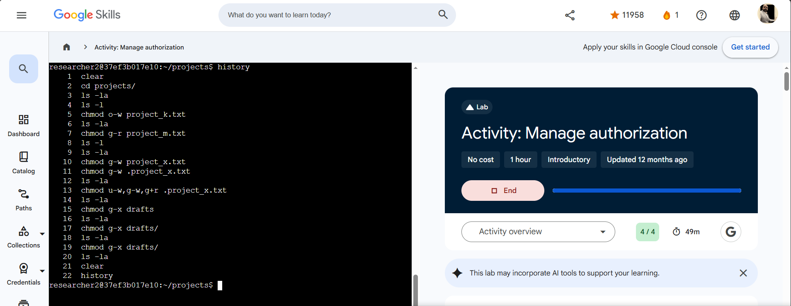

# Lab 06 — Manage authorization

**Program:** Google Cybersecurity Professional Certificate — Google Skills
**Date completed:** 2026-11-02
**Score:** 4 / 4
**Level / duration:** Introductory, 1 hour (completed with 49 min left)
**Environment:** Linux Bash shell, user `researcher2` (member of `research_team`), working in `/home/researcher2/projects`
**Evidence note:** Screenshot is his own run (“Activity: Manage authorization”); full 22-command history visible.

## Objective

Audit Linux file and directory permissions against the access that *should* be granted, and fix every case of excess access with `chmod` — including a hidden file and a directory.

## Starting permissions (from the lab's Task 1 listing)

```
drwx--x---  drafts            (user rwx, group --x, other ---)
-rw-rw-rw-  project_k.txt     (everyone can write)
-rw-r-----  project_m.txt     (group can read a restricted file)
-rw-rw-r--  project_r.txt
-rw-rw-r--  project_t.txt
+ hidden file: .project_x.txt (found with ls -la)
```

## Tasks completed

1. **Check file and directory details** — `ls -la` / `ls -l` in `projects/`; identified the group owner and the hidden file.
2. **Change file permissions** — removed other-write from `project_k.txt`; removed group read from restricted `project_m.txt`.
3. **Change permissions on a hidden file** — made archived `.project_x.txt` read-only for user and group (no write for anyone).
4. **Change directory permissions** — removed group execute from `drafts/`, so only `researcher2` can access it and its contents.

## Findings and fixes

| Issue found | Evidence | Fix applied |
|-------------|----------|-------------|
| Group owning all files in `projects/` | listing shows group owner | — identified as `research_team` |
| Hidden file present | `ls -la` | `.project_x.txt` |
| Other users could write `project_k.txt` | `-rw-rw-rw-` | `chmod o-w project_k.txt` |
| Group could read restricted `project_m.txt` | `-rw-r-----` → group = read only | `chmod g-r project_m.txt` |
| Hidden `.project_x.txt` writable by user **and** group | permission check | `chmod g-w .project_x.txt`, then `chmod u-w,g-w,g+r .project_x.txt` (read kept for both, write removed for both) |
| Group could access `drafts/` | `drwx--x---` → group had execute | `chmod g-x drafts` |

## Commands used (full history from evidence screenshot)

```bash
clear
cd projects/
ls -la
ls -l
chmod o-w project_k.txt
ls -la
chmod g-r project_m.txt
ls -l
ls -la
chmod g-w project_x.txt        # see working note — missing dot
chmod g-w .project_x.txt
ls -la
chmod u-w,g-w,g+r .project_x.txt
ls -la
chmod g-x drafts
ls -la
chmod g-x drafts/
ls -la
chmod g-x drafts/
ls -la
clear
history
```

## Working notes — two habits to tighten

- **Line 10:** `chmod g-w project_x.txt` — missing the leading dot, so it targeted a non-existent regular file instead of the hidden `.project_x.txt`. Corrected immediately at line 11. With hidden files, the dot is part of the name, not decoration.
- **Lines 15, 17, 19:** `chmod g-x drafts` run three times, with an `ls -la` check after each. After the first change is verified in the listing, repeating the identical command changes nothing — harmless, but redundant. One change + one verification is the tight pattern he used everywhere else in this lab.

## Verification

- After every `chmod`, he re-listed with `ls -la` / `ls -l` and read the permission string again before moving on.
- All 4 lab checks passed: **Score 4 / 4**.

## Why this matters for a security analyst

This is least-privilege in practice. World-writable files (`-rw-rw-rw-`), a group reading a restricted file, a writable archive, and a group-traversable drafts folder are exactly the misconfigurations that turn a minor account compromise into data loss or tampering. Reading a 10-character permission string fluently — file type, then user/group/other rwx — is a core audit skill, and it transfers directly to checking real servers.

## Portfolio blurb (copy-ready)

> Completed a hands-on Linux authorization lab (4/4) auditing and fixing file permissions as user researcher2: read permission strings with `ls -la`, removed other-write from a world-writable file (`chmod o-w`), removed group read from a restricted file (`chmod g-r`), set a hidden archive file read-only for user and group (`chmod u-w,g-w,g+r`), and removed group execute from a directory (`chmod g-x`) — verifying the permission string after every change.

## Evidence

- Screenshot: `~/workspace/user/media_library/image/image-12.png` — Activity page, Score: 4/4, 49m left, full terminal `history` (22 commands). Copy in this folder: `lab-06-screenshot.png`.


